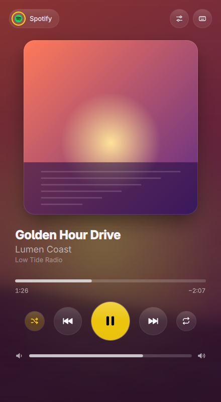

# Tono



A glassy now-playing window for Omarchy. Tono shows what Spotify, or any
other music player, is playing, follows along with synced lyrics, searches
Spotify, and controls it all from the keyboard: the cover,
blurred and slowly turning behind a see-through window, tints the glass the
way Apple Music's player does, and every color comes from the current Omarchy
theme, live.

Tono talks to players over MPRIS on the session D-Bus, so it needs no API
keys or logins: the Spotify desktop app, browsers playing YouTube Music or
SoundCloud, mpv, and terminal players like spotify_player all show up on
their own. When several are open, Tono follows whichever starts playing,
and the pill at the top switches between them.

## Spotify out of sight

Tono doesn't play audio itself: the Spotify app does, and Tono is its
remote. When Tono opens and Spotify isn't running, Tono starts it in the
background (Preferences can turn that off). To never see Spotify's window,
send it to a hidden special workspace with a Hyprland rule in
`~/.config/hypr/hyprland.lua`, and a key to peek at it in `bindings.lua`:

```lua
o.window("Spotify", { workspace = "special:music silent" })
o.bind("SUPER + ALT + M", "Show or hide Spotify", hl.dsp.workspace.toggle_special("music"))
```

Playing without the Spotify app, through a Spotify Connect client like
librespot, isn't possible for most accounts: since late 2025 Spotify denies
those clients the keys to decrypt songs on newer accounts, and has said it is
phasing them out.

## Lyrics

Press L, or the speech bubble, and the lyrics take the cover's place. When
the song has time-synced lyrics, they follow the music like Apple Music's: the
line being sung lights up, and clicking a line jumps the song there. Lyrics
come from [LRCLIB](https://lrclib.net), a free and open lyrics database that
needs no account. Tono sends it the title, artist, album and length of the
song, and only while the lyrics are showing.

## Search

Ctrl + F (or /) opens search: songs and playlists on Spotify, and your own
playlists. Picking a result plays it in the Spotify app, over MPRIS, which
works on any Spotify plan.

Searching inside Tono goes through the Spotify Web API, with a developer app
of your own. Since February 2026, Spotify only runs such Development Mode apps
for owners with Premium, and up to five users you add to them. To connect:

1. Create an app at [developer.spotify.com/dashboard](https://developer.spotify.com/dashboard)
   and tick the Web API.
2. Add the redirect URI `http://127.0.0.1:8898/callback`.
3. Paste its Client ID into Tono's search sheet and press Connect, then
   approve in the browser.

Tono uses PKCE, so there's no client secret; the refresh token is kept in
`~/.config/tono/spotify.json`, readable by you alone, and Disconnect in
Preferences forgets it. Without an account, Enter (or "Search in the Spotify
app") hands the search to the Spotify app instead.

## Shortcuts

| Key | Action |
| --- | --- |
| Space | Play or pause |
| N, Ctrl + → | Next track |
| P, Ctrl + ← | Previous track |
| ← / → | Back or forward 10 seconds |
| ↑ / ↓ | Volume up or down |
| S | Shuffle |
| R | Repeat (off, playlist, track) |
| Ctrl + F, / | Search Spotify |
| L | Lyrics |
| Tab | Next player |
| O | Show the player's window |
| , | Preferences |
| ? | All shortcuts |
| Q | Quit |

## Preferences

Preferences (`,`) set how see-through the window is, how strongly the cover
colors it, soft iOS-like corners instead of the theme's window rounding, the
drifting cover, and whether Tono follows whatever starts playing. They're
kept in `~/.config/tono/tono.conf`. Colors aren't a preference: they always
follow the Omarchy theme, light or dark.

The glass blur is Hyprland's own (`decoration:blur`), which Omarchy turns on;
Tono never changes your Hyprland or Omarchy config.

## Build and install

```sh
bin/build      # qmake6 + make into build/tono
bin/test       # the Qt Test suite, offscreen
bin/install    # builds the Arch package and installs it with makepkg -fsi
```

After `bin/install`, Tono is in the app launcher (Super + Space).

Tono follows the language picked under Omarchy's Setup > Language. It ships
English and Spanish; other languages show in English until a catalog in
`src/i18n/` covers them.

## License

MIT. The theme and translator classes follow Omacut and Monologue by David
Heinemeier Hansson.
